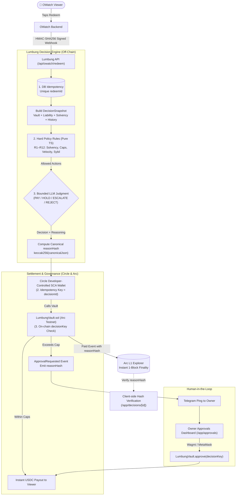

# Lumbung 🌾

**An Autonomous AI Treasurer that runs OWatch's money on Arc.**  
Built for the **Tameion Agents Hackathon** (Canteen × Circle).

> A *lumbung* is the traditional Javanese and Indonesian village rice barn: filled at harvest, guarded with care, and opened prudently during the lean season. *Tameion* is ancient Greek for the treasury room. Lumbung is that timeless community barn, operated by an autonomous AI agent, settled in native USDC on Arc (Circle's stablecoin L1).

---

## Pitch & The Problem

**OWatch** is an active watch-to-earn platform providing supplementary income for underpaid viewers in Indonesia. Viewers earn reward points by watching educational and creator videos, and redeem those points directly for USDC. 

Managing a watch-to-earn treasury presents three hard financial problems:
1. **Points are a balance-sheet liability:** Every point issued is a promise to pay. If outstanding points exceed the treasury reserve, the platform becomes insolvent.
2. **Payouts are frequent, micro-scale, and bursty:** Hundreds of sub-dollar transactions ($0.10 to $0.50) make high-fee chains unusable. This is precisely what **Arc** (sub-second finality, ~$0.01 gas fees paid in USDC) was engineered for.
3. **Manual human approval does not scale, but unconstrained AI is dangerous:** A human cannot review 500 redemptions a day, yet an LLM must never have unconstrained access to move funds.

**Lumbung solves this with an autonomous, bounded AI treasury loop:**
- **Solvency-Aware:** Continuously monitors the reserve ratio (`vault USDC / points liability`) and runway.
- **Fast Autonomous Payouts:** Legitimate redemptions are evaluated and paid via a Circle developer-controlled smart contract account (SCA) in seconds.
- **On-Chain Policy Envelopes:** Daily and per-transaction spending caps live inside the `LumbungVault` smart contract. The AI *cannot* talk past them.
- **Cryptographic Audit Trail:** Every decision commits a canonical hash (`reasonHash`) of its input snapshot, rules, and reasoning to the Arc blockchain.
- **Three-Layer Exactly-Once Guarantee:** Idempotency is enforced at the database, Circle API, and smart contract levels.

---

## Quick Links

- **Live Landing Page:** [https://lumbung.vercel.app](https://lumbung.vercel.app) *(OWatch story & transparency layer)*
- **Live Treasury Dashboard:** [https://lumbung.vercel.app/app](https://lumbung.vercel.app/app) *(Royal Granary on Arc L1)*
- **Demo Video:** [https://youtu.be/TBD](https://youtu.be/TBD) *(< 3 min walk-through)*
- **LumbungVault on Arc Explorer:** [https://explorer.testnet.arc.io/address/0xTBD](https://explorer.testnet.arc.io)
- **Tameion Submission Answers:** [`docs/10-SUBMISSION.md`](docs/10-SUBMISSION.md)
- **Architecture & Specs:** [`docs/02-ARCHITECTURE.md`](docs/02-ARCHITECTURE.md) · [`docs/03-CONTRACT.md`](docs/03-CONTRACT.md) · [`docs/04-AGENT.md`](docs/04-AGENT.md) · [`docs/05-API.md`](docs/05-API.md)

---

## Architecture

Lumbung combines off-chain AI reasoning with immutable on-chain policy enforcement:



### The 3-Layer Exactly-Once Payout Guarantee

To prevent double payouts across distributed retries, network glitches, or malicious re-submissions:
1. **Database Layer:** `redeemRequests.redeemId` has a `UNIQUE` constraint in PostgreSQL. Replays immediately return the existing decision state.
2. **Circle Layer:** Circle transaction submissions use `idempotencyKey = decisionId` (UUID v4). Duplicate requests return the in-flight or completed transaction.
3. **Smart Contract Layer:** `LumbungVault.sol` tracks `executedKeys[decisionKey]`. Any reuse of the same `decisionKey` (`keccak256(decisionId)`) reverts on-chain.

---

## How Lumbung Uses Circle & Arc

| Component | Technology | Implementation Detail |
|---|---|---|
| **Agent Signer** | **Circle Developer-Controlled Wallets** | SCA (Smart Contract Account) deployed on `ARC-TESTNET`. Gas is sponsored by Circle Gas Station. Executes `pay()` and `requestApproval()` contract calls programmatically with idempotency keys. |
| **Settlement & Gas** | **USDC on Arc** | ERC-20 USDC (`0x3600000000000000000000000000000000000000`) is both the settlement medium and native gas token. Sub-second finality enables instant viewer payouts. Internal calculations use integer micro-USDC (6 decimals, `1 USDC = 1_000_000`). |
| **Policy Enforcement** | **`LumbungVault.sol` (Arc Foundry)** | Solidity ^0.8.24 contract managing budget envelopes (`REWARD`, `CREATOR`, `OPS`). Strictly enforces per-transaction and daily rolling caps that off-chain agents cannot bypass. Complies with Arc's `maxFeePerGas >= 20 gwei` mempool rules. |
| **Auditability** | **On-Chain Cryptographic Attestation** | Decisions commit a `reasonHash` (`keccak256(canonicalJson(...))`) directly into `Paid` and `ApprovalRequested` event logs. Anyone can verify what data and reasoning led to a payout. |

---

## How to Verify a Payout Yourself

1. **Find a Decision:** Navigate to `/app/decisions` on the [Lumbung Dashboard](https://lumbung.vercel.app/app/decisions) and select any confirmed payout.
2. **Inspect the Arc Explorer:** Click the transaction hash to open it on the [Arc Testnet Explorer](https://explorer.testnet.arc.io).
3. **Inspect the `Paid` Event:** View the event logs to see `decisionKey`, `category`, `recipient`, `amountMicro`, and `reasonHash`.
4. **Verify Cryptographic Reason Hash:** On the decision detail page (`/app/decisions/[id]`), click the **"Verify reasonHash"** button. The dashboard:
   - Takes the immutable off-chain JSON snapshot, hard rules, chosen action, and AI reasoning.
   - Computes canonical JSON (alphabetically sorted keys, decimal bigint strings, zero whitespace).
   - Computes `keccak256` locally in your browser.
   - Compares the client hash with the `reasonHash` emitted by `LumbungVault.sol` on Arc.

---

## Traction (Tameion Hackathon)

*Live data from `/api/public/stats` (synthetic simulator traffic strictly excluded):*

| Metric | Current Status | Notes |
|---|---|---|
| **Businesses Onboarded** | **1** | OWatch (live watch-to-earn platform) |
| **Unique Viewers Paid** | `[TODO: __ viewers]` | Real viewers on Arc Testnet |
| **Total Payouts Executed** | `[TODO: __ payouts]` | Sub-dollar micro-payouts |
| **USDC Value Moved** | `[TODO: $__ USDC]` | Micro-USDC settlement |
| **AI Autonomous Decisions** | `[TODO: __ decisions]` | Autonomous PAY vs HOLD vs ESCALATE |
| **Human Agreement Rate** | `[TODO: __%]` | Rate at which human approved agent recommendations |
| **Average Decision Latency**| **< 3 seconds** | Webhook receive → Rule engine → LLM → Circle execution |

---

## Human Setup Checklist (Step-by-Step)

Follow these steps in exact order to deploy, fund, and run Lumbung locally or in production:

### Step 1: Register Circle Entity Secret (Task H1)
*⚠️ Money-Safety Rule: The entity secret registration script must be run directly by the human operator. Never commit the recovery file.*
```bash
cd web
pnpm tsx scripts/register-entity-secret.ts
```
- Enter your **Circle API Key** (from [developer.circle.com](https://developer.circle.com)).
- Generate a new 32-byte hexadecimal entity secret.
- The script securely registers the entity ciphertext with Circle and writes a recovery file to `~/.circle/lumbung_recovery_file.dat` (strictly outside the repository).
- Add the printed keys to `web/.env.local`:
  ```env
  CIRCLE_API_KEY="TEST_API_KEY:..."
  CIRCLE_ENTITY_SECRET="64_char_hex_secret..."
  ```

### Step 2: Create Circle Agent SCA Wallet (Task B2)
```bash
cd web
pnpm circle:setup
```
- Creates a Developer-Controlled Wallet Set named `"Lumbung"`.
- Creates 1 Smart Contract Account (SCA) on `ARC-TESTNET` (gas-sponsored by Circle Gas Station).
- Add the output to `web/.env.local`:
  ```env
  CIRCLE_WALLET_SET_ID="wallet-set-uuid"
  CIRCLE_AGENT_WALLET_ID="agent-wallet-uuid"
  CIRCLE_AGENT_WALLET_ADDRESS="0x..."
  ```

### Step 3: Setup Approver & Deployer Wallets (Task H2)
1. Set `OWNER_ADDRESS` in `web/.env.local` to your personal MetaMask/Rabby address (used for approving escalations).
2. Generate or export a temporary deployer private key (`DEPLOYER_PRIVATE_KEY`).
3. Add Arc Testnet to your wallet:
   - **RPC URL:** `https://rpc.testnet.arc.io`
   - **Chain ID:** `5042002`
   - **Currency Symbol:** `USDC`
4. Fund your deployer address and owner address with testnet USDC from [faucet.circle.com](https://faucet.circle.com).

### Step 4: Provision Database & Run Migrations (Task H3)
1. Create a serverless PostgreSQL database on [Neon](https://console.neon.tech).
2. Set `DATABASE_URL` in `web/.env.local`.
3. Run Drizzle migrations:
   ```bash
   cd web
   pnpm db:migrate
   ```
   *Creates tables, the `decision_status` analytical view, and the append-only audit trigger.*

### Step 5: Deploy `LumbungVault.sol` Contract (Task A3)
```bash
cd contracts
./scripts/deploy.sh
```
- Uses Arc Foundry (`arc-forge` / `forge`).
- Enforces Arc's mempool rule: `maxFeePerGas >= 20 gwei` (configured to 25 gwei max, 20 gwei priority).
- Records deployment details to `contracts/deployments/arc-testnet.json`.
- Copy the deployed address into `web/.env.local`:
  ```env
  LUMBUNG_VAULT_ADDRESS="0x..."
  NEXT_PUBLIC_LUMBUNG_VAULT_ADDRESS="0x..."
  ```

### Step 6: Fund the Vault (Task A4)
```bash
cd contracts
./scripts/fund-vault.sh
```
- Approves test USDC and executes `deposit(uint256,bytes32)` with reference `"seed"`.
- Default deposit is 100 USDC (`100_000_000` micro-USDC).
- Verifies on-chain vault balance using `cast call`.

### Step 7: Configure Telegram Notifications (Task H4)
1. Create a Telegram bot via [@BotFather](https://t.me/BotFather) and obtain the `TELEGRAM_BOT_TOKEN`.
2. Send a message to your new bot, then obtain your chat ID (via `getUpdates` or [@userinfobot](https://t.me/userinfobot)).
3. Add to `web/.env.local`:
   ```env
   TELEGRAM_BOT_TOKEN="123456789:ABC..."
   TELEGRAM_OWNER_CHAT_ID="987654321"
   ```

### Step 8: Configure LLM & Webhook Secret
Add your LLM completion endpoint and OWatch shared webhook secret to `web/.env.local`:
```env
LLM_BASE_URL="https://api.openai.com/v1"  # or any OpenAI-compatible router
LLM_API_KEY="sk-..."
LLM_MODEL="gpt-4o-mini"
LLM_TIMEOUT_MS=12000

OWATCH_WEBHOOK_SECRET="generate_a_secure_random_string"
APP_URL="http://localhost:3000"
CRON_SECRET="generate_a_cron_secret"
```
*(Note: If LLM variables are omitted, Lumbung safely degrades to rules-only mode: fallback action is always `HOLD`, never moving money blindly).*

### Step 9: Deploy to Vercel & Schedule Cron (Task F3)
1. Push to GitHub and import the repository on [Vercel](https://vercel.com).
2. Configure environment variables in the Vercel project settings.
3. Schedule periodic treasury health ticks every 15 minutes by setting an external cron (e.g. [cron-job.org](https://cron-job.org)) hitting:
   ```
   POST https://your-deployment.vercel.app/api/agent/tick
   Header: Authorization: Bearer <CRON_SECRET>
   ```

### Step 10: Run OWatch End-to-End Simulation (Task F1)
```bash
cd web
pnpm dev       # in terminal 1
pnpm simulate  # in terminal 2
```
- Posts a solvency snapshot to `/api/owatch/snapshot`.
- Executes all 4 demo scenarios:
  1. **Normal viewer:** autonomous `PAY` in seconds.
  2. **Same viewer 3x velocity:** triggers velocity threshold → `HOLD/ESCALATE`.
  3. **Above per-transaction cap (10 USDC > 5 USDC):** contract cap triggered → `ESCALATE` (awaiting owner approval).
  4. **Low reserve ratio (< 1.0):** small redeem (0.50 USDC) `PAYS`; larger redeem (2.00 USDC) `HOLDS` for top-up.
- Displays a formatted verification table with status and agent reasoning.

---

## Repository Structure

```
lumbung/
├── contracts/                  # Arc Foundry Solidity smart contracts
│   ├── src/
│   │   └── LumbungVault.sol    # Vault contract: envelopes, caps, escalations, pause
│   ├── script/
│   │   └── Deploy.s.sol        # Foundry deployment script
│   ├── scripts/
│   │   ├── deploy.sh           # Testnet deployment with >= 20 gwei gas enforcement
│   │   └── fund-vault.sh       # Script to deposit initial test USDC
│   └── test/
│       └── LumbungVault.t.sol  # 17 Foundry unit tests (97%+ coverage)
├── web/                        # Next.js 15 App Router & API backend
│   ├── scripts/
│   │   ├── register-entity-secret.ts # One-time Circle entity secret tool (HUMAN only)
│   │   ├── circle-setup.ts     # Developer-controlled SCA wallet creator
│   │   ├── circle-smoke.ts     # Wallet inspection smoke test
│   │   └── simulate-owatch.ts  # End-to-end OWatch scenario testbench (DEV ONLY)
│   └── src/
│       ├── agent/              # Decision engine: snapshot, hard rules, LLM, executor
│       │   ├── snapshot.ts     # Builds fresh solvency snapshot
│       │   ├── rules.ts        # Pure TypeScript rule engine (R1–R12)
│       │   ├── llm.ts          # Bounded LLM client with Zod validation
│       │   ├── decide.ts       # Main decision pipeline
│       │   └── execute.ts      # Circle transaction execution & status polling
│       ├── app/                # Next.js App Router (Landing + App route groups)
│       │   ├── (landing)/      # Landing page explaining OWatch & Lumbung transparency
│       │   ├── app/            # Main application (Royal Treasury)
│       │   │   ├── page.tsx    # Royal Granary dashboard & live solvency metrics (/app)
│       │   │   ├── /decisions  # Append-only audit feed & cryptographic reasonHash verifier
│       │   │   ├── /approvals  # Human-in-the-loop owner approval interface (Wagmi)
│       │   │   └── /metrics    # Platform traction & payout statistics
│       │   └── /api/           # Webhooks, cron ticks, and public stats
│       └── lib/                # Shared utilities (HMAC, viem, canonical JSON, Neon DB)
└── docs/                       # Architectural specifications & hackathon deliverables
```

---

## Local Development Commands

All web commands are run inside the `web/` directory:

```bash
cd web

pnpm dev          # Start local development server (port 3000)
pnpm build        # Build production Next.js bundle (verifies zero-env compilation)
pnpm test         # Run Vitest test suite (unit tests, rules, HMAC, execute, simulator)
pnpm typecheck    # Run TypeScript strict type-checking (tsc --noEmit)
pnpm lint         # Run Next.js / ESLint linter
pnpm simulate     # Execute OWatch simulator testbench (requires OWATCH_WEBHOOK_SECRET)
```

Run contract tests in `contracts/`:

```bash
cd contracts
arc-forge test    # Run 17 contract tests on Arc Foundry
```

---

## Roadmap (P2 Items)

- **USYC Idle Reserve Sweep:** Automatically sweep unallocated vault reserves into Hashnote USYC (short-term US yield-bearing token supported on Arc) to generate real yield for the treasury reserve (requires Circle institutional allowlisting).
- **CCTP Cross-Chain Top-Up:** Integrate Circle CCTP and Bridge Kit to automatically top-up the Arc vault from OWatch's primary revenue accounts on Base.
- **Creator Escrow Milestones:** Extend vault budgets to release escrowed creator and editor compensation upon verified video view milestones (forking `circlefin/arc-escrow`).
- **ERC-8004 Agent Identity:** Register Lumbung's agent identity and autonomous track record on-chain using the ERC-8004 standard.
- **Advanced Bot Detection:** Deploy a lightweight heuristic machine learning classifier to detect Sybil viewing farms before redemptions reach the rule engine.
- **Arc Mainnet Migration:** Migrate the vault contract and SCA agent signer to Arc Mainnet upon public availability.

---

## Team & Attribution

Built for the **Tameion Agents Hackathon** (Canteen × Circle) by **Rakyavara Artomily** ([@artomily](https://github.com/artomily)) in collaboration with **OWatch**.
