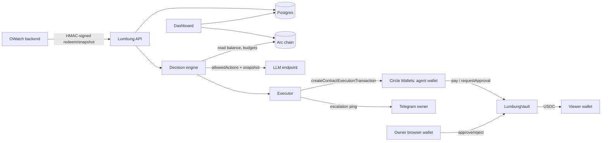
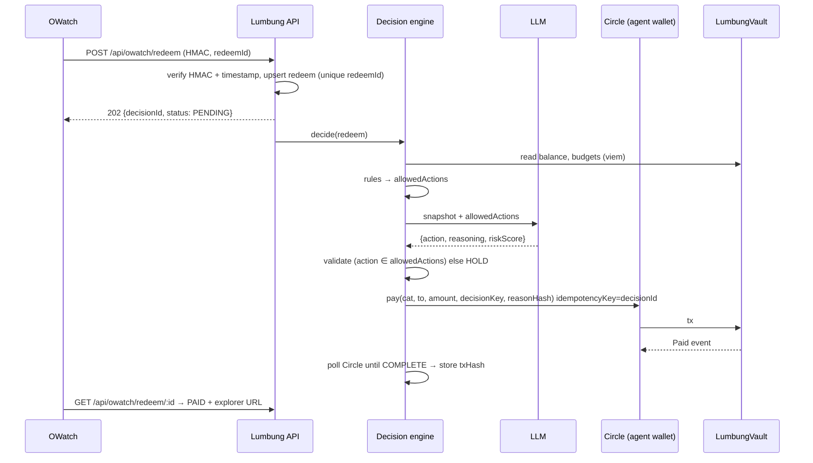

# 02: Architecture

## Repo layout (target)
```
lumbung/
├── AGENTS.md / CLAUDE.md
├── README.md
├── .env.example
├── contracts/                    # Arc Foundry project
│   ├── foundry.toml
│   ├── src/LumbungVault.sol
│   ├── test/LumbungVault.t.sol
│   ├── script/Deploy.s.sol
│   └── deployments/arc-testnet.json   # written by deploy step: {vault, owner, agent, usdc, txHash, block}
├── web/                          # Next.js 15 app = dashboard + API + agent
│   ├── src/app/
│   │   ├── page.tsx                      # overview
│   │   ├── decisions/page.tsx            # decision feed
│   │   ├── decisions/[id]/page.tsx       # one decision: snapshot, rules, reasoning, tx
│   │   ├── approvals/page.tsx            # owner approvals (wallet connect)
│   │   ├── metrics/page.tsx              # traction metrics
│   │   └── api/
│   │       ├── owatch/redeem/route.ts            # POST intake
│   │       ├── owatch/redeem/[redeemId]/route.ts # GET status
│   │       ├── owatch/snapshot/route.ts          # POST liability snapshot
│   │       ├── approvals/confirm/route.ts        # POST owner tx hash → verify receipt
│   │       ├── agent/tick/route.ts               # POST (CRON_SECRET)
│   │       ├── creator/claims/route.ts           # P1
│   │       └── public/stats/route.ts             # GET metrics JSON
│   ├── src/lib/
│   │   ├── env.ts            # zod-validated env
│   │   ├── money.ts          # micro-USDC helpers (bigint)
│   │   ├── hmac.ts           # OWatch signature verify
│   │   ├── arc.ts            # viem public client, vault reads, receipt verify, event reads
│   │   ├── circle.ts         # Circle SDK wrapper: executePay, executeRequestApproval, pollTx
│   │   ├── telegram.ts
│   │   ├── abi/LumbungVault.ts
│   │   └── db/{schema.ts, client.ts}
│   └── src/agent/
│       ├── snapshot.ts       # build DecisionSnapshot
│       ├── rules.ts          # hard rules → allowedActions + ruleResults (pure, unit-tested)
│       ├── llm.ts            # prompt + JSON schema + zod + fallback
│       ├── decide.ts         # orchestrates snapshot → rules → llm → Decision
│       ├── execute.ts        # Decision → Circle tx → decision_events
│       └── tick.ts           # P1 periodic review
├── scripts/
│   ├── circle-setup.ts       # (human runs) create wallet set + agent wallet; prints IDs
│   ├── fund-vault.ts         # transfer test USDC into vault
│   └── simulate-owatch.ts    # DEV ONLY fake redeems (source='simulator')
└── docs/
```

## Components and trust boundaries


Who can move money:
| Actor | Can | Cannot |
|---|---|---|
| Agent wallet (Circle) | `pay` within category caps; `requestApproval` | exceed caps; withdraw; change budgets; unpause |
| Owner (human browser wallet) | approve/reject requests, set budgets, pause, withdraw | — |
| Lumbung server | ask Circle to sign as agent | anything the agent can't |
| LLM | choose among `allowedActions` | call any tool or sign anything |

## Main sequence: redeem → payout

On Vercel, run `decide` + `execute` inside the request using `after()` from `next/server` (or `waitUntil`) so the 202 returns fast. Polling Circle continues in the same background task with a ~25 s budget; anything unfinished is picked up by `tick` / the status GET (re-poll by stored Circle tx id).

## Escalation sequence
1. Executor calls `requestApproval(cat, to, amount, decisionKey, reasonHash)` via Circle. Contract stores the pending request and emits `ApprovalRequested`.
2. Telegram message to owner: amount, user, agent's recommendation + one-line reason, link `APP_URL/approvals?d=<decisionId>`.
3. Owner connects wallet (wagmi, injected connector), calls `approve(decisionKey)` or `reject(decisionKey)`.
4. Page POSTs the tx hash to `/api/approvals/confirm`; server verifies the receipt + event via viem, then appends `OWNER_APPROVED`/`OWNER_REJECTED` + `CONFIRMED` events.

## Key design decisions
- **Envelopes are on-chain categories, not separate wallets.** One vault, caps per category: simpler and the caps are enforced where the agent can't reach.
- **Owner is a human-held browser wallet, not a Circle wallet.** Otherwise the server would hold both keys and the "limit the agent cannot reach" claim would be false. Fallback (only if blocked): owner = second Circle wallet triggered from Telegram button; document as weaker in README.
- **Three-layer idempotency** (DB unique redeemId, Circle idempotencyKey, contract `usedDecision`).
- **reasonHash on-chain**: `keccak256(canonicalJSON({snapshot, ruleResults, action, reasoning}))`, so anyone can verify the logged reasoning wasn't edited after the fact.
- **Testnet first; mainnet toggle via env.** Arc mainnet exists (chain 5042); switching is config + redeploy, done only with explicit human approval.
